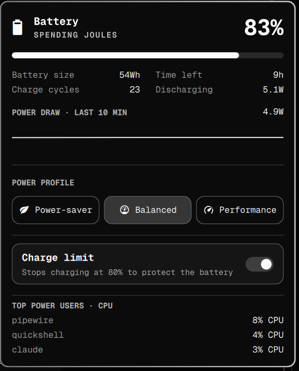

# Battery Control

An Omarchy bar widget: the built-in battery panel, plus a switch for your
laptop's charge limit, a graph of power draw over the last ten minutes, and
the apps using the most CPU right now.



## What it adds

- **Charge limit.** Turns your battery's charge limit on or off from the
  panel. With it on, the laptop stops charging at the limit your firmware
  or UPower has set (often 80%), which is easier on the battery when it sits
  on the charger. It uses UPower's own `EnableChargeThreshold`, so no root or
  sysfs writes are involved. The switch appears only on batteries that
  support it.
- **Watts graph.** Battery draw, or charge rate while plugged in, sampled
  every 10 seconds for the last 10 minutes. It starts over when you plug in
  or unplug, so the graph only ever shows one direction.
- **Top power users.** The three apps using the most CPU over a two-second
  sample. Linux has no per-app watt meter, so CPU time stands in for power.
  It counts only your own processes and groups them by name.

Everything else (the battery icon, the percentage, power profiles, battery
size, cycles, time left) is Omarchy's own Power widget, unchanged.

## Install

```sh
omarchy plugin add https://github.com/gig3m/omarchy-battery-control.git --enable
omarchy plugin disable omarchy.power
```

Disable the built-in Power widget so you don't get two battery icons. Battery
Control answers to the same `omarchy.power` IPC target, so the
`Super + Ctrl + P` shortcut opens it instead.

Right-click the icon to show or hide the percentage next to it.

## Requirements

- Omarchy 4.5 or later.
- UPower 1.90 or later for the charge limit, on a battery whose driver
  supports a charge threshold. Without that, the switch stays hidden and the
  rest works.

## Cost

Nothing runs while the panel is closed except the watts sample, which reads a
value UPower already holds and starts no process. While the panel is open, the
CPU sample and the charge-limit read add about 90 ms of CPU every 5 seconds,
measured on a 2026 MacBook Air (M5).

## Development

The parsing helpers in `Model.js` have tests:

```sh
node --test tests/
omarchy plugin validate .
```

## License

MIT. Battery Control starts from Omarchy's Power widget, © David Heinemeier
Hansson, also MIT. See [LICENSE](LICENSE).
